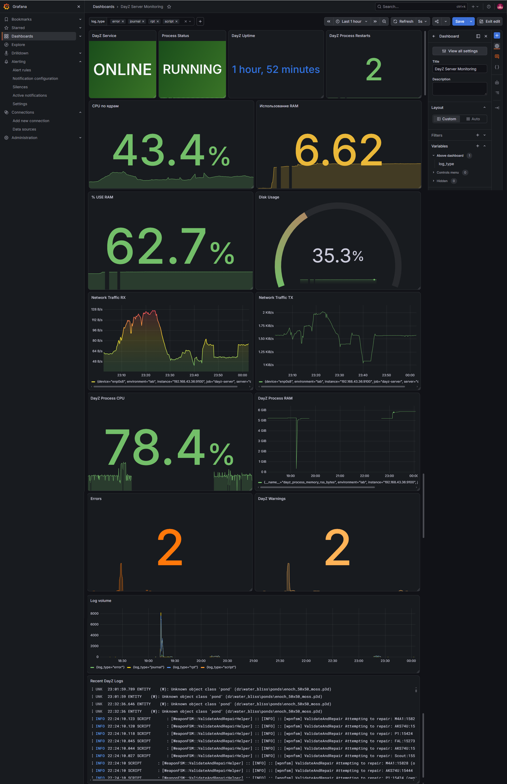

# DayZ Dedicated Server Infrastructure

A self-hosted DayZ Dedicated Server infrastructure deployed on Ubuntu Linux. The project includes mod configuration, AI integration, system monitoring, centralized log management, and process-level metrics.

This repository documents a practical DevOps lab focused on Linux administration, service management, monitoring, logging, and infrastructure troubleshooting.

## Documentation

- [DayZ Dedicated Server Installation Guide](docs/installation/dayz-server-installation.md) — complete installation and configuration guide, including SteamCMD, Workshop mods, server configuration, and systemd.


## Project Overview

The infrastructure consists of two virtual machines:

- **DayZ Server** — runs the DayZ Dedicated Server, Node Exporter, and Grafana Alloy.
- **Monitoring Server** — runs Prometheus, Grafana, and Loki.

The environment is built with Oracle VirtualBox and Ubuntu Linux.

## Architecture

```text
+----------------------------------+
|          DAYZ SERVER             |
|          Ubuntu Linux            |
|                                  |
|  +----------------------------+  |
|  |    DayZ Dedicated Server   |  |
|  |    systemd service         |  |
|  |    AI and server mods      |  |
|  +----------------------------+  |
|                |                 |
|       +--------+--------+        |
|       |                 |        |
|  Node Exporter     Grafana Alloy |
|  System Metrics    Log Collection|
+-------|-----------------|--------+
        |                 |
        |                 |
        v                 v
+----------------------------------+
|        MONITORING SERVER         |
|          Ubuntu Linux            |
|                                  |
|  +-------------+  +-----------+  |
|  | Prometheus  |  |   Loki    |  |
|  | Metrics     |  |   Logs    |  |
|  +------+------+  +-----+-----+  |
|         |               |        |
|         +-------+-------+        |
|                 |                |
|             +---v---+            |
|             |Grafana|            |
|             +-------+            |
+----------------------------------+
```

## Technology Stack

| Component | Technology |
|---|---|
| Operating System | Ubuntu 26.04.1 LTS |
| Virtualization | Oracle VirtualBox |
| Game Server | DayZ Dedicated Server |
| Service Management | systemd |
| Metrics Collection | Prometheus |
| System Metrics | Node Exporter |
| Log Collection | Grafana Alloy |
| Log Aggregation | Grafana Loki |
| Visualization | Grafana |
| Scripting | Bash |
| Process Metrics | Linux `/proc` filesystem |

## Repository Structure

```text
dayz-dedicated-server/
├── README.md
├── docs/
│   └── screenshots/
│       └── dayz-dashboard.png
├── monitoring/
│   ├── alloy/
│   │   └── config.alloy
│   ├── loki/
│   │   └── config.yaml
│   └── prometheus/
│       └── prometheus.yml
├── scripts/
│   └── dayz-service-metrics.sh
└── systemd/
    └── dayz.service
```

## DayZ Dedicated Server

The DayZ server runs on Ubuntu Linux and is managed by systemd.

Implemented features:

- Dedicated server deployment.
- systemd service configuration.
- Automatic restart on service failure.
- Mod configuration.
- DayZ Expansion AI integration.
- Server log collection.
- Process-level monitoring.

The server is configured to use UDP port `2302`.

### systemd Service

The service definition is available at:

[`systemd/dayz.service`](systemd/dayz.service)

The unit runs the server under a dedicated `dayz` system user and uses systemd for lifecycle management.

Before deployment, adjust the working directory, executable path, configuration file, and mod parameters to match your environment.

## Monitoring

The monitoring stack uses Prometheus and Node Exporter to collect infrastructure and application metrics.

### System Metrics

- CPU utilization.
- Memory usage.
- Disk utilization.
- Network traffic.
- Node Exporter availability.

### DayZ Process Metrics

A custom Bash script collects additional metrics from the DayZ systemd service and Linux `/proc` filesystem.

The script exports:

| Metric | Description |
|---|---|
| `dayz_service_up` | systemd service availability |
| `dayz_service_main_pid` | Main process ID |
| `dayz_process_up` | Process availability |
| `dayz_process_cpu_seconds_total` | Total process CPU time |
| `dayz_process_memory_rss_bytes` | Resident memory usage |
| `dayz_process_start_time_seconds` | Process start timestamp |
| `dayz_process_uptime_seconds` | Process uptime |
| `dayz_process_restarts_total` | Detected process restarts |

Script location:

[`scripts/dayz-service-metrics.sh`](scripts/dayz-service-metrics.sh)

The restart counter detects changes in the process PID. It is a custom tracking metric, not a complete systemd restart-event counter.

The script writes metrics in Prometheus textfile format for collection by Node Exporter.

### Prometheus Configuration

Configuration file:

[`monitoring/prometheus/prometheus.yml`](monitoring/prometheus/prometheus.yml)

Prometheus scrapes:

- Its own metrics endpoint.
- The local Node Exporter.
- The DayZ server Node Exporter endpoint.

The example configuration uses a documentation-only placeholder IP address. Replace it with the actual DayZ VM address before deployment.

## Centralized Logging

Grafana Alloy runs on the DayZ VM and forwards logs to Grafana Loki on the Monitoring VM.

### Collected Log Sources

- DayZ RPT logs.
- Script logs.
- Error logs.
- systemd journal logs for `dayz.service`.

### Alloy Configuration

[`monitoring/alloy/config.alloy`](monitoring/alloy/config.alloy)

The configuration includes file discovery, log collection, labeling, and forwarding to Loki.

Update the Loki endpoint and log directory paths to match your environment.

### Loki Configuration

[`monitoring/loki/config.yaml`](monitoring/loki/config.yaml)

Loki uses local filesystem storage and TSDB indexing.

**Security note:** The example configuration has authentication disabled. Keep Loki restricted to a trusted private network. Do not expose this configuration directly to the public internet.

## Grafana Dashboard

The Grafana dashboard provides a unified view of infrastructure health, DayZ process performance, and server logs.



Dashboard panels include:

- DayZ service availability.
- Process status and uptime.
- Process restart tracking.
- CPU utilization per core.
- RAM utilization.
- Disk usage.
- Network traffic.
- DayZ process CPU and memory usage.
- Error and warning statistics.
- Log volume.
- Recent DayZ log entries.

Log data can be filtered by type using a Grafana dashboard variable.

## Deployment and Configuration

The repository contains configuration examples and scripts. It does not include DayZ server binaries, Steam Workshop mod files, or a fully automated installation procedure.

A deployment follows this general order:

1. Prepare the Ubuntu virtual machines and private network.
2. Install and configure the DayZ Dedicated Server and required mods.
3. Configure the DayZ systemd service using `systemd/dayz.service`.
4. Install Node Exporter and configure its textfile collector.
5. Deploy the custom metrics script and configure periodic execution.
6. Install Prometheus and apply `monitoring/prometheus/prometheus.yml`.
7. Install Loki and apply `monitoring/loki/config.yaml`.
8. Install Grafana Alloy on the DayZ VM and apply `monitoring/alloy/config.alloy`.
9. Configure Prometheus and Loki data sources in Grafana.
10. Build and verify the monitoring dashboard.

### Configuration Checklist

Before starting services, review these environment-specific settings:

- DayZ server installation path.
- DayZ mod list and startup parameters.
- DayZ VM IP address in Prometheus configuration.
- Loki endpoint in Alloy configuration.
- DayZ profile and log paths in Alloy configuration.
- Node Exporter textfile collector directory.
- File ownership and permissions for scripts and log files.
- Firewall rules and access restrictions between VMs.

## Project Status

**Implemented and tested:**

- DayZ Dedicated Server deployment on Ubuntu.
- systemd service management.
- Mod and AI configuration.
- Prometheus metrics collection.
- Custom DayZ process metrics.
- Grafana dashboards.
- Loki log aggregation.
- Grafana Alloy log forwarding.
- Centralized DayZ log exploration.
- Process restart tracking.

## Skills Demonstrated

- Linux system administration.
- Ubuntu server deployment.
- systemd service management.
- Bash scripting.
- Linux process and `/proc` inspection.
- Prometheus monitoring.
- Node Exporter configuration.
- Grafana dashboard development.
- Loki log aggregation.
- Grafana Alloy configuration.
- Virtual machine networking.
- Infrastructure troubleshooting.

## Future Improvements

- Infrastructure deployment automation.
- Configuration management with Ansible.
- Backup and recovery automation.
- Improved alerting and notification workflows.
- Dashboard provisioning and export.
- Automated configuration validation.
- CI checks for configuration files.

---

**Project type:** Personal DevOps Lab / Portfolio Project  
**Platform:** Ubuntu Linux / VirtualBox  
**Focus:** Linux Infrastructure, Monitoring, Centralized Logging, Game Server Administration